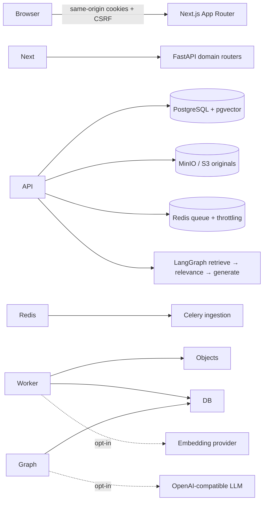

# KnowledgeForge AI

**Less searching. More knowing.**

A full-stack, multi-tenant knowledge intelligence portfolio: real document ingestion, permission-aware search, persistent conversations, and inspectable citations. Built as a modular monolith plus an ingestion worker—not an autonomous tool-using agent.

**Portfolio reference, not a production-certified service.** The complete enterprise specification is larger than this implementation. See [limitations](#limitations) and the [validation report](docs/VALIDATION.md).

!\[KnowledgeForge dashboard — synthetic demonstration](docs/images/dashboard.png)

## Recruiter quick start — no paid API key

Prerequisites: **Python 3.12+**, **Node 22 LTS**, npm, Bash (macOS/Linux/WSL), free ports 3000/8000, and network access to install dependencies and download the tokenizer on first run.

```sh
make demo
```

Open **http://localhost:3000** and select **Explore demo workspace**.

The script creates a virtual environment, installs the pinned Python lock and npm lock, seeds synthetic documents, and starts both services. It **forces AI and email integrations off**, even if your shell has credentials. Demo state lives outside the repository at `$HOME/.local/share/knowledgeforge-demo` (override with `KNOWLEDGEFORGE\_DEMO\_DATA`). Stop with Ctrl+C. No cloud resources are created.

Demo identity: `alex@demo.knowledgeforge.local` / `DemoWorkspace!2026`. This intentionally public identity is for a **local, synthetic demo only**. Do not expose it publicly or upload confidential documents. Create your own account to exercise organization isolation.

### What happens without an LLM?

The application really extracts, chunks, stores, retrieves, and cites your documents. It clearly labels returned source passages as **Extractive mode**, not fabricated AI-generated answers. SQLite demo search is keyword-based. The Docker stack uses PostgreSQL full-text search; embeddings add semantic/hybrid retrieval only when a provider is deliberately configured.

## Full local Docker stack

Requirements: Docker Engine + Compose v2 and network access. Plan for at least 10 GB of free disk (constrained VFS runtimes may need substantially more). Avoid concurrent builds on 2 GB hosts. A first MinIO source build can take several minutes; use the lightweight demo for the fastest tour.

```sh
cp .env.example .env
# Use local-only example values, or change the development passwords.
docker compose build minio # serialize the memory-intensive first source build
docker compose up --build -d
python3 scripts/wait\_ready.py
docker compose exec api python -m app.seed
```

Open **http://localhost:3000**. To avoid a port conflict, prefix Compose commands with `WEB\_PORT=3001` and open port 3001. MinIO console is loopback-only at port 9001. Database, broker, and API ports are not published.

MinIO's older public images were unavailable during review, so the Dockerfile builds a pinned upstream release from source; the bucket initializer uses the existing boto3 integration. See [third-party licensing](THIRD_PARTY.md) for **MinIO's AGPL license**. No unavailable prebuilt MinIO image is required.

Do not reuse these development settings for a hosted service. `docker compose down` stops the stack. **`down -v` permanently removes local database/storage volumes.**

## Architecture



**Web:** React, strict TypeScript, Tailwind/CSS, React Hook Form, Zod, Lucide. **API:** Python, FastAPI/Pydantic v2, SQLAlchemy async, Alembic. **Operations:** Docker Compose, structured logs, FastAPI OTel instrumentation, GitHub Actions definition. [Detailed design](docs/architecture/OVERVIEW.md).

## Implemented and exercised

* Email/password registration creates an organization, owner membership and initial workspace.
* Argon2id passwords; hashed opaque HttpOnly sessions; authenticated CSRF checks; origin checks; atomic rotation and one-time reset/verification-token consumption.
* Organization membership and owner/admin/member/viewer permissions enforced by the API.
* Workspaces, document upload/download/deletion, private/org visibility, access updates and processing status.
* PDF/DOCX/Markdown/text extraction; token-aware overlapping chunks; Celery retries; idempotent chunk commits.
* Signature/UTF-8 checks, DOCX archive expansion/path/XML/macro checks, filename/size limits and streamed request-body limits. **Not a malware scanner or parser sandbox.**
* Authorized full-text + pgvector retrieval; LangGraph retrieval/generation; multi-turn history; insufficient-evidence abstention; numeric citation checks.
* Search/source inspector, personal conversations, members/roles, audit JSON export, current-state analytics, profile/settings, responsive layout and themes.
* Redis-backed auth/chat rate limiting in Compose; bounded in-process fallback in the lightweight demo.

### Evidence relevance and abstention

Search returns ranked candidates, not guaranteed answers. Chat applies a shared, conservative evidence gate before extractive output or LLM generation: topical-term coverage, required literal numeric/quoted qualifiers, and no pooling of unrelated partial passages. Weak evidence produces an explicit abstention with **no citations**. Extractive citations reference exactly the passages shown.

Defaults: `RELEVANCE\_MIN\_COVERAGE=0.8`, `RELEVANCE\_MIN\_MATCHES=2` (capped by query term count). This is an explainable English lexical safeguard, not a semantic confidence score; it may reject synonyms or otherwise answerable questions. See [relevance strategy, regression results and limitations](docs/testing/RELEVANCE.md).

## Validation snapshot

The table below records the earlier portfolio audit. The subsequent relevance patch was separately tested: **63 passed / 2 skipped on SQLite; 64 passed / 1 skipped on PostgreSQL/pgvector**. Its skipped checks need external services; the full Compose suite was not rerun for this patch.
Actual review results—not benchmarks or accuracy claims:

|Check|Result|
|-|-|
|Patched Python lock, SQLite/local suite|**41 passed, 2 explicitly skipped**|
|Patched Docker suite: PostgreSQL/pgvector + Redis/S3/Celery|**43 passed**|
|Vitest / React Testing Library|**10 passed**|
|Playwright Chromium against the full Compose stack|**3 passed**|
|TypeScript strict check / Next production build|**passed**|
|Live upload → worker → search → chat → citations → permissions → delete|**passed**|
|pgvector extension and FTS/HNSW indexes|**verified: vector 0.8.2**|
|Frontend full-tree audit / locked Python audit|**0 reported known vulnerabilities**|
|Actionlint|**passed; GitHub Actions Verification #2 succeeded on commit 74dfa42 (local-and-browser and disposable-services jobs)**|

Deterministic mock transports test LLM success, bad/missing references, provider failure, abstention, embedding shape checks and PostgreSQL semantic tenant filtering. **No real LLM call or paid charge was made.** Full commands, failures found, and remaining checks: [validation report](docs/VALIDATION.md).

## Tests and release checks

```sh
# Python environment created by make demo, or your own Python 3.12+ environment
cd apps/api
python -m pip install -r requirements.lock
python -m pytest -q
cd ../web
npm ci
npm run typecheck
npm test
npm run build
npx playwright install --with-deps chromium
# Start and seed a web/API stack first:
npm run test:e2e
```

Disposable integration checks use a **separate database ending in `\_test`**; the fixture refuses other database names. It drops test tables. Never point it at real data.

```sh
cp .env.example .env
docker compose -p forge-test -f docker-compose.yml -f docker-compose.test.yml run --build --rm test
python3 scripts/verify\_stack.py http://localhost:3000 # needs httpx; creates synthetic accounts
# Destructive: only remove this dedicated test project's volumes:
docker compose -p forge-test -f docker-compose.yml -f docker-compose.test.yml down -v
```

For release candidates, `python3 scripts/release.py --check` checks candidate files for banned artifacts and common credential/private-key patterns; `make release` creates an allowlisted ZIP plus external manifest/checksum. It does not commit, push, or deploy. This scan is not a comprehensive secrets-history audit.

## Optional provider configuration

Only do this if you intentionally accept your provider's costs and data-handling terms. The no-key demo and tests do not need it. Configure `OPENAI\_API\_KEY`, `OPENAI\_BASE\_URL`, `CHAT\_MODEL`, and `EMBEDDING\_MODEL` in your Docker `.env`; never expose keys in `NEXT\_PUBLIC\_\*`. Embedding dimension is 1536. Upload/re-ingest content after changing the embedding model; corpus-wide re-embedding is not implemented. SMTP must be configured for reset/verification email delivery. Real-provider and real-SMTP delivery were not tested.

## Limitations

No AWS Terraform deployment, OCR, malware scanner, sandboxed parser, nested collections, workspace-specific ACLs, document version replacement, email invitations, owner transfer, SSO/MFA, streaming answers, token-cost ledger, or historical usage charts. Citation-number validation is **not** semantic entailment verification. There is no database RLS, ingestion outbox/stale-job sweeper, external immutable audit sink, retention/purge policy, or nonce-based CSP. A killed worker can leave an operator-recoverable queued/processing item. Configure trusted proxies and edge throttling before any public deployment.

Configuration rejects unsupported environment/storage/task/encryption modes and non-1536 embedding dimensions. Late chat/document/search responses are ignored after organization changes; pending confirmations and workspace selections are cleared.

The UI is split into screens/shared dialogs and a typed controller hook; the controller and shell still have room for feature-level state decomposition. No accessibility certification, load test, SLO, security certification, or production-readiness claim is made.

## Repository map

* `apps/web/components/screens`, `shared`, `hooks`: views, accessible controls/dialogs, controller state/actions
* `apps/api/app/routes`: auth, organizations, documents, conversations, operations
* `apps/api/app`: shared DB/security, ingestion, storage, RAG workflow and worker tasks
* `packages/shared-contracts`: generated OpenAPI (`make contracts`)
* `infrastructure/docker`, `docker-compose\*.yml`: local services and isolated test DB
* `docs`: architecture, API, security, operational limitations and validation
* `.github/workflows/ci.yml`: local/browser and disposable-service jobs

Project source: MIT. Third-party components retain their own licenses. [Contributing](CONTRIBUTING.md) · [Security](SECURITY.md).

