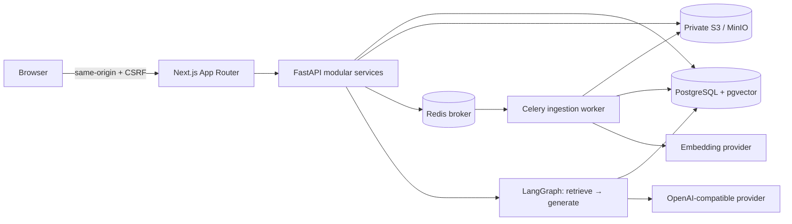

# Architecture

## Trust boundaries
Browser state is never authoritative. Every org-path handler resolves a server-side membership; downloads and retrieval additionally apply document visibility. Owner/admin see org documents including private ones; member/viewer see shared documents and their own private uploads. Conversations are user-private, including from admins. Message citations are access-checked again on history reads; any inaccessible citation hides the associated assistant message.

## Data flow
Upload validates extension, size, workspace and role → stores opaque org/document object key → creates queued metadata → dispatches task. The worker extracts pages, tokenizes at 480 tokens with 64-token overlap, embeds in batches of 64, and replaces the chunk set in a transaction. A final row lock/status check prevents duplicate committed chunk sets. Unique (document_id, ordinal) is a second guard. PDF page numbers are retained. Scanned content fails explicitly. Failed attempts expose a generic message and log a server-side exception.

Queue dispatch is not transactional with the database: no outbox yet. A crash after storing metadata or before dispatch can leave queued work requiring operator recovery. Late acknowledgments + bounded retries do not guarantee exactly-once execution. External embedding calls can be duplicated on redelivery, although committed chunks are idempotent.

## Retrieval
PostgreSQL selects authorized chunk candidates with a full-text rank and, if vectors/key exist, a cosine-distance ranking. Semantic candidates beyond distance 0.65 are rejected; up to 30 per ranking enter reciprocal rank fusion with k=60. Top six enter generation. The threshold is a configurable-code heuristic, not evaluated calibration. GIN/HNSW indexes are installed by the initial PostgreSQL migration. Tenant filters remain in both ranking queries. At scale, measure filtered HNSW recall and consider iterative scans/partitioning.
When precise PostgreSQL terms return no match, a safe OR query over normalized keywords provides a relaxed full-text fallback. This is not a semantic-confidence score.

SQLite fallback inspects up to 2,000 permitted chunks and ranks keyword intersections. It is explicitly non-semantic and development-only.

## Answers
LangGraph has explicit retrieve and generate nodes. Follow-ups append one previous user question for short queries. The model gets at most eight history messages and six chunks. Evidence is marked untrusted; no model tools or network execution are exposed. Without evidence, abstain. Without provider configuration, return labeled extracts. Model answers must include valid numeric citation references. This detects missing/out-of-range references but **does not establish entailment or stop every prompt injection**.

## Operations
Structured JSON logs record route/status/duration and worker failures without request bodies. FastAPI OpenTelemetry instrumentation is enabled; exporting traces needs an exporter/collector configuration. No SLOs or benchmarks have been measured. The modular monolith shares its models/services with the worker rather than introducing unnecessary microservices.
